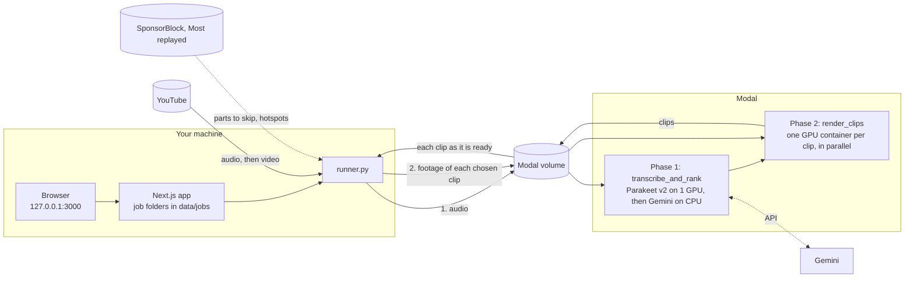

# AI Podcast Clipper

Turn a long podcast or interview into ranked, ready-to-post vertical clips for YouTube Shorts, Instagram Reels and TikTok.

Paste a YouTube link or drop an MP4. The app transcribes it, has Gemini find the strongest complete moments anywhere in the video, 30 seconds to 2 minutes long as the conversation needs (helped by YouTube's "Most replayed" graph when the video has one), crops each one to 9:16 around whoever is speaking and burns in one-line captions of 3-5 words with the spoken word highlighted, at the same loudness for every clip. The heavy lifting runs on rented cloud GPUs ([Modal](https://modal.com)); nothing stays on Modal, and the video is kept on your machine for a week (outside OneDrive, capped at 10 GB) so a re-rank needs no new download.

A single-user, local-first fork of [Andreaswt/ai-podcast-clipper-saas](https://github.com/Andreaswt/ai-podcast-clipper-saas): no accounts, payments, S3 or database.

**Stack:** Next.js 15 (React 19, Tailwind 4), Python 3.12, Modal (A10 GPUs), NVIDIA Parakeet TDT 0.6B v2, Gemini, LR-ASD, yt-dlp, FFmpeg.

## Demo

https://github.com/user-attachments/assets/4f1256f4-8035-4e74-be25-355fda692fc8

A 37-minute podcast became 5 ranked clips in 7 minutes for about $0.12 of GPU time (measured on the earlier pipeline that uploaded the whole video).

## How it works



1. **Add a video.** The Next.js app creates a job folder and starts `runner.py` in the background. The runner reads the Most replayed graph and SponsorBlock segments (a few seconds, no download).
2. **Phase 1.** The audio goes to Modal first. Parakeet transcribes it and Gemini ranks the moments (no GPU is billed while it ranks). The laptop starts downloading the YouTube video while the audio is still uploading.
3. **Phase 2.** For each chosen clip the laptop cuts that clip's footage out of the video (no re-encode) and uploads only that. Every clip then renders at once in its own GPU container: LR-ASD finds the speaker, and the clip is cropped to 9:16 and encoded once with captions, its audio at -14 LUFS and, for YouTube videos, a credit card over its last 4.5 seconds (the episode's thumbnail, channel and title, and where in the episode the clip starts).
4. **Save.** The runner downloads all clips at once, each as soon as it is ready, and the app shows each clip the moment it is saved. Then it deletes the audio and the footage everywhere and keeps the video only on your machine, for re-ranks.

The two phases overlap the video download with transcription. On `main`, one real 30-minute 1080p60 video took 13 minutes, 468 s of it uploading the whole video. With the two-phase flow, a video of about 40 minutes took 6.8 minutes and one of about 100 minutes took 7.4 minutes (first real runs, on a 4-8 Mbps uplink).

## How it's built

- **Parallel GPU containers:** one A10 per clip, each clip encoded once on NVENC; every video shows its time and estimated cost (Modal plus the Gemini tokens it used).
- **Audio first, then only the footage you need:** the video is never uploaded whole unless it has to be (see [advanced.md](docs/advanced.md#fallbacks-to-the-whole-video)).
- **Parakeet TDT 0.6B v2:** about 111x real time on an A10, English only; chosen over Whisper-family and Parakeet v3 on this project's own podcasts.
- **Complete clips, ranked by value:** Gemini proposes moments and quotes the line where each one pays off; code checks the payoff is inside the cut, and one judge call re-reads every final clip, fixes boundaries and marks incomplete ones, which never outrank complete ones. For YouTube videos the score blends 60% Gemini with 40% how often viewers replay that part. One more call writes each chosen clip's title, caption and hashtags.
- **Nothing kept on Modal:** the video stays on your machine for 7 days after its last use (10 GB cap), so Re-rank reuses it and the saved transcript.
- **Run ledger:** every run is appended to `data/stats/runs.jsonl`, so the stats page keeps its numbers when you delete a video.

## Requirements

- Windows, macOS or Linux (no local GPU needed)
- [Node.js](https://nodejs.org) 20+, [Python 3.12](https://www.python.org/downloads/) and Git
- A [Modal](https://modal.com) account (the Starter plan includes $30/month of credits) and a [Gemini API key](https://aistudio.google.com/apikey) from a project with billing on: the free tier runs out within a few videos a day. Ranking costs about $0.05-0.12 per video on Gemini 3.8 Flash (2026 prices; Google doubles them on 2027-01-01).
- Optional: a [Hugging Face token](https://huggingface.co/settings/tokens), if the first deploy hits download rate limits

## One-time setup

Commands are for PowerShell. On macOS/Linux, activate the venv with `source .venv/bin/activate` and use `cp` instead of `Copy-Item`.

```powershell
git clone https://github.com/Akash-Sakala/ai-podcast-clipper.git
cd ai-podcast-clipper\ai-podcast-clipper-backend
py -3.12 -m venv .venv
.venv\Scripts\Activate.ps1
python -m pip install --upgrade pip
pip install -r requirements-local.txt
Copy-Item .env.example .env

pip install gdown
python download_weights.py          # face-detector weights (about 90 MB), checked by SHA-256

modal setup
modal secret create ai-podcast-clipper-secret GEMINI_API_KEY=<your key> HF_TOKEN=<optional token>
modal deploy main.py                # refuses to deploy if the weights are missing

cd ..\ai-podcast-clipper-frontend
npm install
```

The first deploy builds the CUDA image with the Parakeet weights (about 2.5 GB) and takes a while. After changing settings or bundled code, deploy again: see [what needs a redeploy](docs/advanced.md#when-to-redeploy). With the standard folder layout no frontend `.env` is needed.

## Running

Make a **Podcast Clipper** shortcut once (desktop and Start menu; `-StartAtSignIn` also starts the server when you sign in, so it opens instantly):

```powershell
powershell -ExecutionPolicy Bypass -File scripts\install-shortcut.ps1 -StartAtSignIn
```

The shortcut starts the app if it isn't running, rebuilds it first when the code changed, and opens it in its own window (Chrome's or Edge's app mode). Closing the window leaves the server running; `scripts\clipper.ps1 -Stop` stops it. You can also install it from the browser (the install icon in the address bar) for a taskbar icon.

By hand: `cd ai-podcast-clipper-frontend; npm run build; npm run start` (or `npm run preview`), then open http://127.0.0.1:3000. For development with hot reload use `npm run dev`. The app answers only on this computer and refuses requests from other sites.

**Upgrading from a version that kept its data in the repo:** run `powershell -ExecutionPolicy Bypass -File scripts\move-data.ps1` once. It moves `data\` to `%LOCALAPPDATA%\ai-podcast-clipper\data`, out of OneDrive; until then the app keeps using `data\`.

- **Home:** paste a YouTube link, click **Upload MP4**, or drop a file (up to 4 GB). Each video shows up under **Your videos** with live status.
- **Running video:** **Cancel** stops it (the run on Modal too); **Try again** later picks up where it stopped.
- **Clips page:** clips best first (a poster each; a mouse resting on one plays a muted preview), a full-screen viewer to watch them one after another (arrow keys or a swipe; the address links to the clip), post text for each clip (a Shorts title, a caption and hashtags written by Gemini, plus a credit line; edit it, copy one field or all of it, and mark where you posted the clip), score breakdowns, the Most replayed graph, one-click download or a ZIP. **Re-rank** asks Gemini again without re-transcribing or downloading, then shows the new clips beside the previous ones so you keep the ones you want, clip by clip; **Try again** restarts a failed video; **Render again** renders the same moments once more when every clip failed to render (no Gemini call).
- **Stats** (chart icon) and **Settings** (gear icon: currency, clips per video, Most replayed, audience weight, SponsorBlock, the end credit card, and the kept videos with a button to remove them).

The bin icon on a video's page deletes it (clips, transcript and kept video; its stats stay). Stopping the app does not stop a running video; it carries on and the app catches up when you start it again. Settings, command line and troubleshooting: [docs/advanced.md](docs/advanced.md).

## Limitations

- English only. Needs a Modal account and a Gemini key.
- YouTube sometimes asks to confirm you're not a bot: set up [cookies](docs/advanced.md#youtube-cookies).
- Videos that are not H.264 MP4/MOV with one AAC track upload whole in phase 2 (slower, same result).
- SponsorBlock data is non-commercial (CC BY-NC-SA 4.0); turn it off for commercial use.
- First real runs passed on Modal and Windows; an uploaded MP4 and the recovery paths have only been tested offline.

## Development

```powershell
cd ai-podcast-clipper-backend
pip install -r requirements-dev.txt
python -m pytest tests -q          # offline; torch tests skip without torch
ruff check .

cd ..\ai-podcast-clipper-frontend
npx tsc --noEmit; npm run lint; npm run format:check; npm run build
```

CI ([.github/workflows/ci.yml](.github/workflows/ci.yml)) runs both on every push. The backend folder is flat on purpose: Modal bundles modules by name. What changed from the original project: [CHANGES.md](CHANGES.md). An editable version of the diagram: [docs/architecture.excalidraw](docs/architecture.excalidraw) (open it at [excalidraw.com](https://excalidraw.com)).

## Credits & license

MIT, see [LICENSE](LICENSE). Based on [Andreaswt/ai-podcast-clipper-saas](https://github.com/Andreaswt/ai-podcast-clipper-saas) by Andreas Trolle. Active speaker detection by [LR-ASD](https://github.com/Junhua-Liao/LR-ASD) (MIT). Uses SponsorBlock data licensed under [CC BY-NC-SA 4.0](https://creativecommons.org/licenses/by-nc-sa/4.0/) from [sponsor.ajay.app](https://sponsor.ajay.app/). Exchange rates by [Frankfurter](https://frankfurter.dev) and [ExchangeRate-API](https://www.exchangerate-api.com). Fonts: Geist and Bricolage Grotesque (SIL Open Font License). Demo music: "Happy Beats / Business Moves Vol. 1" by Sascha Ende, [ende.app](https://ende.app) ([CC BY 4.0](https://creativecommons.org/licenses/by/4.0/)).
