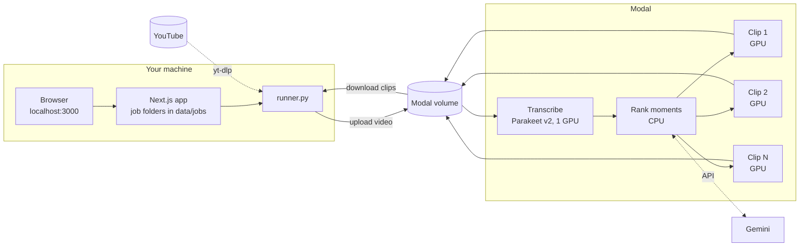

# AI Podcast Clipper

Turn a long podcast or interview into ranked, ready-to-post vertical clips for YouTube Shorts, Instagram Reels and TikTok.

Paste a YouTube link or drop an MP4. The app transcribes it, has Gemini find the strongest 30-60 second moments anywhere in the video, crops each one to 9:16 around whoever is speaking and burns in word-timed subtitles. The heavy lifting runs on a rented cloud GPU ([Modal](https://modal.com)); the app, your videos and the finished clips stay on your machine.

A single-user, local-first fork of [Andreaswt/ai-podcast-clipper-saas](https://github.com/Andreaswt/ai-podcast-clipper-saas): no accounts, payments, S3 or database.

## Demo

https://github.com/user-attachments/assets/4f1256f4-8035-4e74-be25-355fda692fc8

A 37-minute podcast became 5 ranked clips in 7 minutes, for about $0.12 of GPU time.

## Features

- **Best moments, not the first ones:** Gemini scores candidates on hook, standalone sense, payoff, emotion, value and shareability; clips come back ranked with their score and the reason.
- **Fast, accurate transcripts:** [NVIDIA Parakeet TDT 0.6B v2](https://huggingface.co/nvidia/parakeet-tdt-0.6b-v2) transcribes 30 minutes of audio in about 16 seconds on an A10 (English).
- **Speaker-following crop:** [LR-ASD](https://github.com/Junhua-Liao/LR-ASD) active-speaker detection keeps the person talking in frame, without split-second jumps between people.
- **Clips render in parallel:** one GPU container per clip, each clip encoded once on the GPU; every video shows how long it took and what it cost.
- **Clean cuts:** clips start where a thought starts and end where it lands, on whole sentences with a short fade.
- **No repeat work:** adding a video you already clipped (same YouTube video or the same file, even renamed) takes you to its clips or a re-rank instead.
- **Never empty-handed:** if Gemini is busy, the app falls back through other models and then to transcript-based picks, and lets you re-rank later without transcribing again.
- **Clean, live UI:** step-by-step progress, one-click download or ZIP of all clips, light and dark themes.
- **Stats page:** Modal spend per video and per month, end-to-end and per-step times by podcast length, and where each run's time goes.

## How it works



1. **Add a video** in the browser. The Next.js app creates a job folder and starts `runner.py` in the background.
2. **The runner** downloads the YouTube video (or uses your upload), sends it to a Modal volume and starts the job.
3. **On Modal**, Parakeet transcribes the audio on a GPU, then Gemini ranks the moments while no GPU is billed. Then every clip renders at the same time in its own GPU container: LR-ASD finds the speaker, and each clip is cropped to 9:16 and encoded once with subtitles on the GPU's video encoder. Progress is reported back as it goes.
4. **The runner** downloads the finished clips into the job folder, and they appear in the app with the job's processing time and estimated cost.

## Requirements

- Windows, macOS or Linux (no local GPU needed)
- [Node.js](https://nodejs.org) 20+, [Python 3.12](https://www.python.org/downloads/) and Git
- A [Modal](https://modal.com) account (the Starter plan includes $30/month of credits; an A10 costs about $1.10/hour)
- A [Gemini API key](https://aistudio.google.com/apikey)
- Optional: a [Hugging Face token](https://huggingface.co/settings/tokens), if the first deploy hits download rate limits

## One-time setup

Commands are for PowerShell. On macOS/Linux, activate the venv with `source .venv/bin/activate` and use `cp` instead of `Copy-Item`.

**1. Clone and install the backend tools**

```powershell
git clone https://github.com/Akash-Sakala/ai-podcast-clipper.git
cd ai-podcast-clipper\ai-podcast-clipper-backend
py -3.12 -m venv .venv
.venv\Scripts\Activate.ps1
python -m pip install --upgrade pip
pip install -r requirements-local.txt
Copy-Item .env.example .env
```

**2. Download the face-detector weights** (about 90 MB; the rest of LR-ASD is already in `asd/`)

```powershell
pip install gdown
gdown 1KafnHz7ccT-3IyddBsL5yi2xGtxAKypt -O asd\model\faceDetector\s3fd\sfd_face.pth
```

**3. Connect Modal and deploy the GPU backend** (still in `ai-podcast-clipper-backend`)

```powershell
modal setup
modal secret create ai-podcast-clipper-secret GEMINI_API_KEY=<your key> HF_TOKEN=<optional token>
modal deploy main.py
```

The first deploy builds the CUDA image with the Parakeet weights (about 2.5 GB) and takes a while; later deploys are quick. Re-run `modal deploy main.py` after changing `main.py`, `render.py`, `asd/` or `.env`.

**4. Install the frontend**

```powershell
cd ..\ai-podcast-clipper-frontend
npm install
```

With the standard folder layout no frontend `.env` is needed. Copy `.env.example` to `.env` only to change where job data is stored (`DATA_DIR`, best kept outside OneDrive), which Python runs the runner (`RUNNER_PYTHON`), or to let yt-dlp use your browser's YouTube login (`YTDLP_COOKIES_FROM_BROWSER`).

## Running the app

```powershell
cd ai-podcast-clipper-frontend
npm run dev
```

Open http://localhost:3000.

- **Home:** paste a YouTube link, click **Upload MP4**, or drop a file (up to 4 GB). Each video shows up under **Your videos** with its live status; you can keep adding more while others run.
- **Clips page:** click a video to see its clips, best first. Hover the rank badge (`#1 86`) for the score breakdown and Gemini's reason. Download one clip, or everything as a ZIP with **Download all**. **Re-rank** asks Gemini again without re-transcribing; **Try again** restarts a failed video.
- **Stats:** the chart icon in the header shows what each video cost on Modal and how long each step took. For videos processed before it existed, run `python runner.py --backfill-stats` once in `ai-podcast-clipper-backend`.

Finished clips are also saved in `data/jobs/<job id>/clips/`.

Stopping `npm run dev` does not stop a running video; it keeps going and the app catches up when you start it again.

## More

Settings, command-line use, re-ranking, cancelling a running job, tests and troubleshooting: [docs/advanced.md](docs/advanced.md). What changed from the original project: [CHANGES.md](CHANGES.md).
A more detailed, editable architecture diagram: [docs/architecture.excalidraw](docs/architecture.excalidraw) (open it at [excalidraw.com](https://excalidraw.com)).

## Credits & license

MIT, see [LICENSE](LICENSE). Based on [Andreaswt/ai-podcast-clipper-saas](https://github.com/Andreaswt/ai-podcast-clipper-saas) by Andreas Trolle. Active speaker detection by [LR-ASD](https://github.com/Junhua-Liao/LR-ASD) (MIT). Fonts: Geist and Bricolage Grotesque (SIL Open Font License). Demo music: "Happy Beats / Business Moves Vol. 1" by Sascha Ende, [ende.app](https://ende.app) ([CC BY 4.0](https://creativecommons.org/licenses/by/4.0/)).
